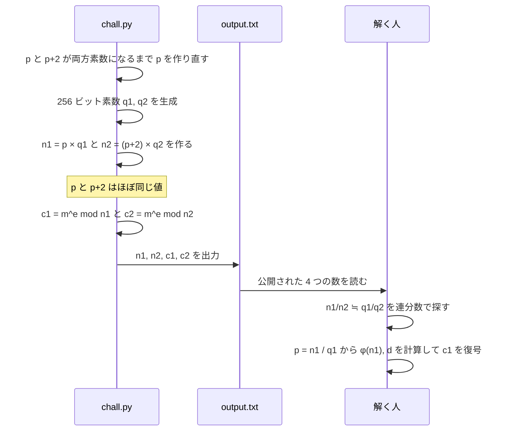
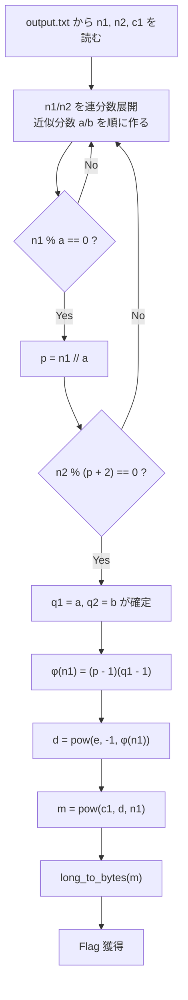

> [!IMPORTANT]
> **Solved with Gemini in Colab**
>
> この問題は Google の AI コーディングアシスタント **Gemini in Colab** を活用して解決されました。

> [!NOTE]
> この Writeup は AI により自動生成されています。 本ドキュメントは、AI アシスタントを用いて作成された Writeup です。記載内容は解法の一例であり、内容の正確性については十分にご確認の上ご利用ください。

# Almost Shared Prime

## 概要
*   **カテゴリー**: Crypto
*   **トピック**: RSA
*   **難易度**: Hard 8.0
*   **問題リンク**: [Almost Shared Prime - Daily AlpacaHack](https://alpacahack.com/daily/challenges/almost-shared-prime)

## 使用ツール
*   **Python 3**: 解法スクリプトの実装（連分数展開は標準機能だけで自作）
*   **pycryptodome**: `Crypto.Util.number.long_to_bytes` による整数 → バイト列の変換（`pip install pycryptodome`）
*   **Gemini in Colab**: 配布ファイルの解析およびコード生成

## 問題の分析
本問題は、**Daily AlpacaHack** の RSA 問題で、前作 [Shared Prime](https://alpacahack.com/challenges/shared-prime) の続編です。問題文は「simple?」の一言で、Beginner Hint として [Small d](https://alpacahack.com/challenges/small-d) と [CopperCopperCopper](https://alpacahack.com/challenges/copper-copper-copper) が挙げられています。配布ファイルは次の 2 つです。

| ファイル | 内容 |
| :--- | :--- |
| `chall.py` | フラグを RSA で 2 回暗号化するスクリプト |
| `output.txt` | `chall.py` の実行結果（`n1`, `n2`, `c1`, `c2` の 4 つの整数） |

`chall.py` の中身は次の通りです。

```python
import os

from Crypto.Util.number import bytes_to_long, getPrime, isPrime

FLAG = os.environ.get("FLAG", "Alpaca{DUMMY}").encode()
e = 65537

while True:
    p = getPrime(1024)
    if isPrime(p + 2):
        break

q1 = getPrime(256)
q2 = getPrime(256)

n1 = p * q1
n2 = (p + 2) * q2
m = bytes_to_long(FLAG)
assert m < min(n1, n2)

c1 = pow(m, e, n1)
c2 = pow(m, e, n2)

print(f"{n1 = }")
print(f"{n2 = }")
print(f"{c1 = }")
print(f"{c2 = }")
```

前作との違いを表にまとめます。

| | Shared Prime（前作） | Almost Shared Prime（今回） |
| :--- | :--- | :--- |
| 1 本目の鍵 | $`n_1 = p\,q_1`$ | $`n_1 = p\,q_1`$ |
| 2 本目の鍵 | $`n_2 = p\,q_2`$ | $`n_2 = (p+2)\,q_2`$ |
| $`p`$ の大きさ | 1024 ビット | 1024 ビット（しかも $`p+2`$ も素数） |
| $`q_1, q_2`$ の大きさ | 各 1024 ビット | **各 256 ビット（小さい）** |
| $`\gcd(n_1, n_2)`$ | $`p`$（これで解ける） | **1（共通の素数なし）** |

2 つの鍵は素数を「共有」していませんが、$`p`$ と $`p+2`$ は差がたった 2 の **双子素数** で、「ほぼ（Almost）共有」しています。これが問題名の意味です。

| 変数 | 意味 | 公開されているか | 今回の値の大きさ |
| :--- | :--- | :---: | :--- |
| $`p`$, $`p+2`$ | 双子素数（それぞれの鍵の大きい方の素因数） | ❌ | 1024 ビット |
| $`q_1`$, $`q_2`$ | それぞれの鍵の小さい方の素因数 | ❌ | 各 256 ビット |
| $`n_1`$, $`n_2`$ | 公開鍵の法（モジュラス） | ✅ | 各 1279 ビット（10 進 385 桁） |
| $`e`$ | 公開指数 `65537` | ✅（`chall.py` に記載） | 17 ビット |
| $`c_1`$, $`c_2`$ | 同じフラグ $`m`$ の暗号文 | ✅ | ― |

※ ビット数・桁数は、配布された `output.txt` から solve.py で実際に計算した値です。$`\gcd(n_1, n_2) = 1`$ も実際に計算して確認しており、前作の gcd による解法はそのままでは使えません。

`chall.py` が `output.txt` を作るまでの流れと、今回の解き方を図にすると次のようになります。



## 脆弱性の詳細

### RSA のおさらい
RSA は次のように鍵を作り、暗号化・復号します（$`p, q`$ は異なる素数）。

$$
\begin{aligned}
n &= p\,q \\
\varphi(n) &= (p-1)(q-1) \\
e\,d &\equiv 1 \pmod{\varphi(n)} \\
c &= m^{e} \bmod n \quad \text{(encrypt)} \\
m &= c^{d} \bmod n \quad \text{(decrypt)}
\end{aligned}
$$

公開されるのは $`(n, e)`$ だけで、秘密鍵 $`d`$ を作るには $`n`$ の素因数が必要です。つまり今回も **$`n_1`$ か $`n_2`$ のどちらかを素因数分解できれば勝ち** です。

### n1 / n2 は q1 / q2 にとても近い
2 つの $`n`$ の比をとってみます。

$$
\frac{n_1}{n_2} = \frac{p\,q_1}{(p+2)\,q_2} = \frac{q_1}{q_2} \cdot \frac{p}{p+2}
$$

$`p`$ は 1024 ビットもある巨大な数なので、$`\dfrac{p}{p+2} = 1 - \dfrac{2}{p+2}`$ はほとんど 1 です。そのため

$$
\frac{n_1}{n_2} \approx \frac{q_1}{q_2},
\qquad
\left| \frac{n_1}{n_2} - \frac{q_1}{q_2} \right| = \frac{q_1}{q_2} \cdot \frac{2}{p+2}
$$

となり、**公開されている分数 $`n_1 / n_2`$ が、分母がたった 256 ビットの秘密の分数 $`q_1 / q_2`$ で極めて正確に近似できる** ことが分かります。実際の値で計算すると、このずれは約 $`2^{-1022}`$ でした。

### 連分数で q1 / q2 を取り出す
「ある実数を、分母の小さい分数でうまく近似する」ための道具が **連分数展開** です。分数 $`x`$ を次の形に書き、

$$

x = k_0 + \cfrac{1}{k_1 + \cfrac{1}{k_2 + \cfrac{1}{k_3 + \cdots}}}
$$

途中で打ち切って得られる分数 $`h_i / g_i`$ を **近似分数（convergent）** と呼びます。係数 $`k_i`$ はユークリッドの互除法の商そのもので、近似分数は次の漸化式で順に計算できます。

$$
\begin{aligned}
h_i &= k_i\,h_{i-1} + h_{i-2}, & h_{-2} &= 0,\ h_{-1} = 1 \\
g_i &= k_i\,g_{i-1} + g_{i-2}, & g_{-2} &= 1,\ g_{-1} = 0
\end{aligned}
$$

そして、次の **ルジャンドルの定理** が鍵になります。

> [!TIP]
> **ルジャンドルの定理**: 既約分数 $`a/b`$ が
>
> $$
> \left| x - \frac{a}{b} \right| < \frac{1}{2\,b^{2}}
> $$
>
> を満たすなら、$`a/b`$ は $`x`$ の近似分数のどれかと一致する。

$`q_1, q_2`$ は異なる素数なので $`q_1 / q_2`$ は既約分数です。条件に当てはめると、

$$
\frac{q_1}{q_2} \cdot \frac{2}{p+2} < \frac{1}{2\,q_2^{2}}
\iff
4\,q_1\,q_2 < p + 2
$$

となります。$`q_1 q_2`$ は約 512 ビット、$`p`$ は 1024 ビットなので、この条件は大差で成り立ちます。

| 量 | 実際の値から計算した大きさ |
| :--- | :--- |
| ずれ $`\lvert n_1/n_2 - q_1/q_2 \rvert`$ | 約 $`2^{-1022.2}`$ |
| ルジャンドルの定理の上限 $`1/(2 q_2^2)`$ | 約 $`2^{-512.6}`$ |
| $`n_1/n_2`$ の近似分数の総数 | 454 個 |
| $`q_1/q_2`$ が現れた位置 | 156 番目 |

つまり、**$`n_1 / n_2`$ の近似分数を先頭から順に調べれば、必ずどこかで $`q_1 / q_2`$ が出てくる** わけです。近似分数は高々数百個なので、全部試しても一瞬で終わります。

> [!NOTE]
> Beginner Hint の [Small d](https://alpacahack.com/challenges/small-d) で使われる **Wiener の攻撃** も、「公開値の比が秘密の分数を良く近似する」ことを連分数で突く攻撃です。本問は同じ道具を、$`e/n`$ ではなく $`n_1/n_2`$ に使っています。

### 正しい近似分数の見分け方
どの近似分数が $`q_1/q_2`$ かは事前に分からないので、候補 $`a/b`$ ごとに「本当に割り切れるか」で確かめます。

| チェック | 意味 |
| :--- | :--- |
| $`n_1 \bmod a = 0`$ | $`a`$ が $`n_1`$ の約数 → $`p = n_1 / a`$ の候補ができる |
| $`n_2 \bmod (p+2) = 0`$ | その $`p`$ について $`p+2`$ も $`n_2`$ を割り切る → 正解 |

2 つ目のチェックまで通るのは、本物の $`q_1/q_2`$ のときだけです。

### p から秘密鍵 d を作る
$`p`$ と $`q_1`$ が分かれば、あとは前作と同じ教科書どおりの RSA 復号です。

$$
\begin{aligned}
p &= n_1 / q_1 \\
\varphi(n_1) &= (p-1)(q_1-1) \\
d &= e^{-1} \bmod \varphi(n_1) \\
m &= c_1^{\,d} \bmod n_1
\end{aligned}
$$

今回の値で実際に確かめると $`\gcd(e, \varphi(n_1)) = 1`$ だったので、Python の `pow(e, -1, phi)` でそのまま $`d`$ を計算できます。最後に `long_to_bytes(m)` で整数を文字列に戻せばフラグが得られます。

### 補足: なぜ近似分数は「良い近似」になるのか

連分数の近似分数には、次の性質があります。

$$
\left| x - \frac{h_i}{g_i} \right| < \frac{1}{g_i\,g_{i+1}} \le \frac{1}{g_i^{2}}
$$

分母 $`g_i`$ で作れる分数の間隔はおよそ $`1/g_i`$ なので、普通は誤差も $`1/g_i`$ 程度になります。近似分数はその **2 乗** の精度 $`1/g_i^2`$ を達成しており、「分母の大きさの割に異常に正確な分数」です。

ルジャンドルの定理はこの逆向きで、「誤差が $`1/(2b^2)`$ より正確な分数は、近似分数以外にはありえない」ことを保証します。今回の $`q_1/q_2`$ は誤差 $`2^{-1022}`$ 程度で、分母 $`q_2`$（256 ビット）に対して $`1/(2q_2^2) \approx 2^{-513}`$ よりはるかに正確なので、近似分数の列に必ず現れます。

### 補足: なぜ $`c^{d} \bmod n`$ で元に戻るのか

$`e\,d \equiv 1 \pmod{\varphi(n)}`$ なので、ある整数 $`k \ge 0`$ を使って $`e\,d = 1 + k\,\varphi(n)`$ と書けます。$`\gcd(m, n) = 1`$ のとき、オイラーの定理 $`m^{\varphi(n)} \equiv 1 \pmod{n}`$ より

$$
\begin{aligned}
c^{d} &\equiv (m^{e})^{d} = m^{e d} \\
&= m^{1 + k\,\varphi(n)} \\
&= m \cdot \left(m^{\varphi(n)}\right)^{k} \\
&\equiv m \cdot 1^{k} = m \pmod{n}
\end{aligned}
$$

となります。さらに `chall.py` の `assert m < min(n1, n2)` により $`0 \le m < n_1`$ が保証されているので、$`c_1^{d} \bmod n_1`$ の結果はちょうど $`m`$ そのものになります。

### 攻撃フロー


> [!TIP]
> 2 本目の鍵 $`(n_2, c_2)`$ でも同じことができます。$`n_2 = (p+2)\,q_2`$ なので $`\varphi(n_2) = (p+1)(q_2-1)`$ です。solve.py ではこれで $`c_2`$ も復号し、$`c_1`$ から得たものと同じ $`m`$ になることを確認用に表示しています。

> [!WARNING]
> 「素数が同じでなければ安全」とは限りません。今回のように、鍵どうしの素数が **近い値** だったり、素因数のサイズが極端に偏っていたりすると、公開値の比から秘密が漏れることがあります。RSA の素数は、鍵ごとに十分な乱数から独立に、同程度のサイズで生成する必要があります。

## 用語解説
*   **RSA**: 大きな数の素因数分解が難しいことを安全性の根拠とする公開鍵暗号です。公開鍵 $`(n, e)`$ で暗号化し、秘密鍵 $`d`$ で復号します。
*   **双子素数**: $`p`$ と $`p+2`$ がどちらも素数であるような組です（例: 11 と 13）。`chall.py` は `isPrime(p + 2)` が真になるまで $`p`$ を作り直しています。
*   **最大公約数（gcd）**: 2 つの整数を両方とも割り切る最大の整数です。前作ではこれで共有素数が求まりましたが、今回は $`\gcd(n_1, n_2) = 1`$ です。
*   **連分数展開**: 数を $`k_0 + 1/(k_1 + 1/(k_2 + \cdots))`$ の形に書き表すことです。係数 $`k_i`$ はユークリッドの互除法の商として求まります。
*   **近似分数（convergent）**: 連分数展開を途中で打ち切って得られる分数です。分母の大きさの割に、元の数を非常に正確に近似します。
*   **ルジャンドルの定理**: $`\lvert x - a/b \rvert < 1/(2b^2)`$ を満たす既約分数 $`a/b`$ は、必ず $`x`$ の近似分数になる、という定理です。今回の攻撃が必ず成功する根拠です。
*   **Wiener の攻撃**: RSA の秘密鍵 $`d`$ が小さすぎるとき、$`e/n`$ の連分数展開から $`d`$ を求める攻撃です。本問と同じく連分数を使います。
*   **オイラーのトーシェント関数 $`\varphi(n)`$**: $`1`$ 以上 $`n`$ 以下で $`n`$ と互いに素な整数の個数です。$`n = pq`$（$`p \neq q`$ は素数）なら $`\varphi(n) = (p-1)(q-1)`$ です。
*   **モジュラ逆元**: $`e\,d \equiv 1 \pmod{\varphi}`$ を満たす $`d`$ のことです。Python 3.8 以降では `pow(e, -1, phi)` で求められます。
*   **`bytes_to_long` / `long_to_bytes`**: pycryptodome の関数で、バイト列とそれを big-endian で読んだ整数を相互に変換します。

## 解決スクリプト
[solve.py を参照してください](./solve.py)

```bash
pip install pycryptodome
python3 solve.py ./almost-shared-prime/output.txt
```

配布ファイル（`almost-shared-prime.tar.gz`）は問題ページから各自ダウンロードし、展開してから実行してください。
